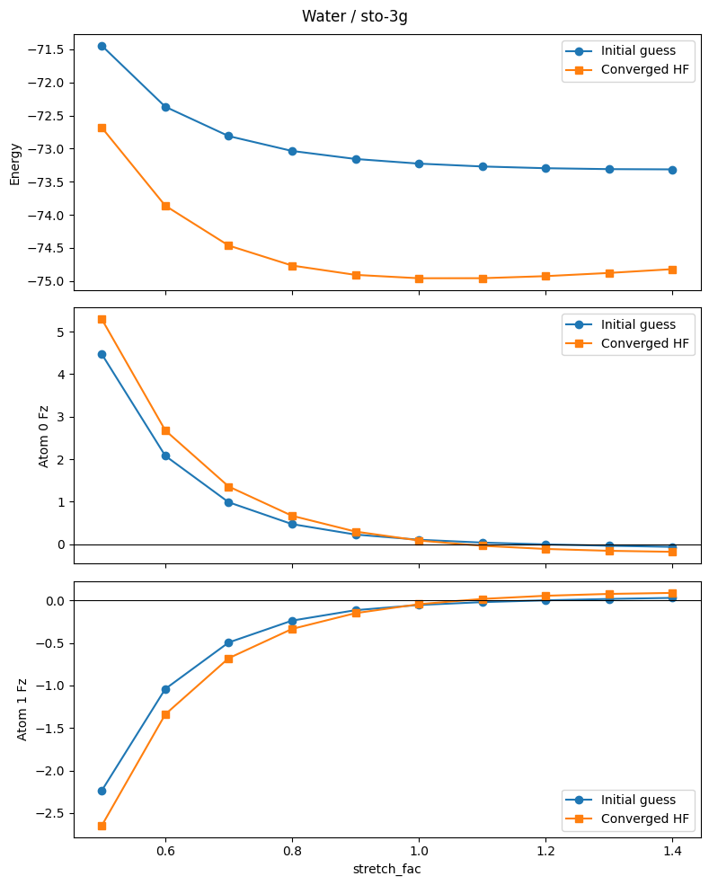

# GPU accelerated version of PyQuante2

This code is modeled after [PyQuante2](https://github.com/rpmuller/pyquante2), a pure-Python quantum chemistry package. 
Currently, this code includes only a GPU-enabled integral engine, which is fully backpropagatable with respect to any input through PyTorch's autodiff functionality.

## Usage

This package can be installed from the repository with `pip install .`.

The two main helper classes are `Molecule` and `BasisSet`. A helper function, `load_sample_molecule()`, is defined in `atoms/molecule.py` for loading molecules defined in `samples/samples.py`. The `Molecule` class can also load `.xyz` files.

The `BasisSet` class takes a `Molecule` instance and a basis set name. It expects the corresponding `.gbs` file to exist in `pyquante2g/basis/cart_gto_data`. A `BasisSet` instance can then be passed to one of the integral engines, which currently include both full dense and 8-fold symmetry implementations (`IntegralEngineBase` and `IntegralEngineSparse`).

All arrays are stored as PyTorch tensors and are therefore fully differentiable. An example is provided in `examples/autodiff_coords.py`, which runs restricted Hartree-Fock and then uses PyTorch's autodiff to compute the derivative of the energy with respect to the nuclear coordinates.

## Code structure
- arb_math: arbitrary precision math
    - core: interface to mpmath and basic funcs
    - functions: funcs needed for ERI
    - eri: implementation of THO's ERI
    - overlap: overlaps and kinetic
    - nai: nuclear attraction integral
- torch_ops: torch-native tensor helpers used by the vectorized code
- atoms: for representing molecules
    - elmements: atomisitic info
    - molecule: classes for atoms and building molecules
- basis: basis set manipulations
    - cart_gto: cart. gto primitives and pairs, calc's integrals
    - cart_gto_data: basis set data files
    - basisset: 
    - cart_gto_utils: util funcs, e.g. generating ang. mom. tuples
    - data: hard-coded basis sets in python data structs
    - one_ints
- utils: utility functions
    - file_utils: 
    - plotting_utils:
- ref_ints: non-batch reference implementation of integrals (numpy)
    - eri: implementation of THO's ERI
    - overlap: overlaps and kinetic
    - nai: nuclear attraction integral

## References
- [Original pyquante2 repo](https://github.com/rpmuller/pyquante2)
- [Hiroshi Taketa, Sigeru Huzinaga, Kiyoshi O-ohata, 1966 (THO66)][tho66]
- [T. Helgaker and P. Tayler 1995 (HT95)][ht95]
- [Minhhuy Hô and Julio-Manuel Hernández-Pérez, 2012 (HH12)][hh12]

[tho66]: https://doi.org/10.1143/JPSJ.21.2313
[ht95]: https://doi.org/10.1142/9789812832115_0001
[hh12]: https://doi.org/doi:10.3888/tmj.14-3

